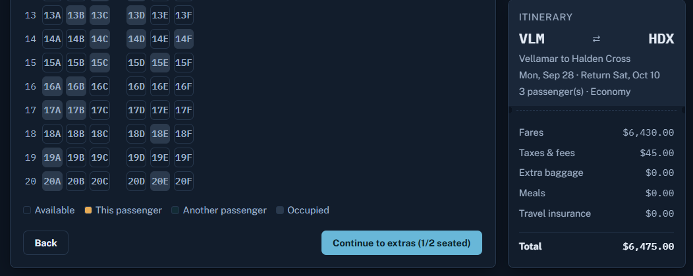

# SkyBook Manual QA Project

End-to-end manual QA project for the SkyBook practice flight-booking application. The project demonstrates requirements analysis, test design, execution, defect reporting, and full traceability in Jira and Zephyr Essential.

## Project Overview

- **Author:** Rahaf AlQura'an
- **Application under test:** [SkyBook Practice Booking](https://claude.ai/code/artifact/5028f8a7-4747-4b7e-b07f-a4dddf65807c)
- **Tools:** Jira, Zephyr Essential, CSV, Excel
- **Testing type:** Manual functional, negative, boundary, and end-to-end testing
- **Execution date:** 7 September 2026

## Results

| Metric | Count |
| --- | ---: |
| Test cases | 37 |
| Passed | 16 |
| Failed | 20 |
| Blocked | 1 |
| Bugs reported | 24 |

The blocked case, TC-6.3-01, could verify the displayed arithmetic but could not verify child-fare and tax-scaling rules because the UI did not expose the required calculation details.

## Highlights

- Built coverage across 7 Epics and 20 User Stories.
- Documented every case with preconditions, exact test data, execution steps, expected result, actual result, and status.
- Reported 24 observable defects and linked failed tests to their affected requirements.
- Created an Epic → Story → Test Case → Bug traceability chain.
- Kept observed behavior separate from assumptions about implementation.

## Repository Contents

- [Test plan](docs/TEST_PLAN.md)
- [Complete execution report](docs/EXECUTION_REPORT.md)
- [Detailed bug reports](docs/BUG_REPORTS.md)
- [Traceability matrix](docs/TRACEABILITY.md)
- [Test cases in CSV](test-cases/SkyBook_Test_Cases.csv)
- [Bug reports in CSV](bugs/SkyBook_Bug_Reports.csv)
- [Traceability matrix in CSV](traceability/SkyBook_Traceability_Matrix.csv)
- [QA project workbook](SkyBook_QA_Project.xlsx)
- [Screenshot evidence gallery](screenshots/README.md)

## Selected Findings

- Search accepted identical origin and destination cities.
- Date validation accepted invalid and past travel dates.
- Passenger validation accepted zero adults and more infants than adults.
- Price sorting and the nonstop filter returned incorrect results.
- Passenger, passport, payment, CVV, and terms validations had multiple gaps.
- Duplicate seat assignment, negative baggage, and repeated promo discounts were possible.
- Starting a new booking retained previous trip selections.

## Evidence Highlights

The Zephyr library contains 37 test cases organized by Epic. Execution records capture the test steps and their results.

The Jira summary shows the requirements and defects tracked during this round of testing.

**BUG-14 — seat completion validation:** The Continue button remained enabled with only one of two passengers assigned a seat. The [Jira defect record](screenshots/BUG-14-details-and-results.png) documents the steps, expected and actual results; the [attachment and story view](screenshots/BUG-14-attachments-and-story-traceability.png) shows its supporting evidence and requirement link. A [seat selection view](screenshots/BUG-14-skybook-seat-selection.png) provides application context.

See the [full screenshot evidence gallery](screenshots/README.md) for the remaining Jira, Zephyr, application, and workbook images.

## Notes

SkyBook is a fictional practice environment. No real payment was processed and all identity data used during testing was synthetic.
